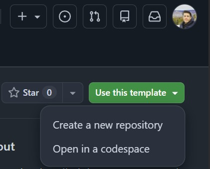
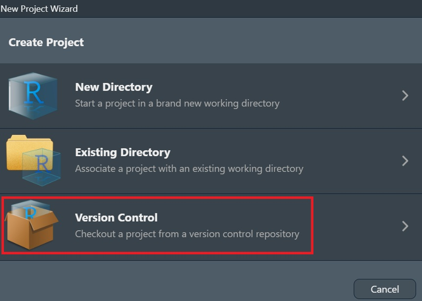
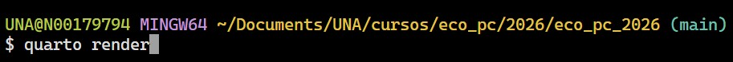
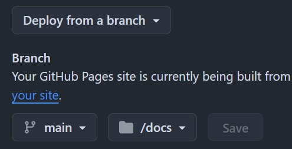

::: institucion
Escuela de Ciencias Biológicas

Universidad Nacional

Ecología de Poblaciones y Comunidades

Profesor: Héctor Zumbado Ulate
:::

## Práctica 1

### Objetivo

Al finalizar esta práctica, el estudiante será capaz de:

- Crear un repositorio a partir de una plantilla (Template Repository) en GitHub.

<!-- -->

- Clonar un proyecto existente desde GitHub hacia RStudio.

<!-- -->

- Renderizar un sitio web desarrollado con Quarto.

<!-- -->

- Publicar el sitio mediante GitHub Pages.

<!-- -->

- Personalizar la portada y el perfil profesional.

<!-- -->

- Comprender la estructura general del portafolio digital que utilizará durante el semestre.

## Introducción

Durante el resto del semestre cada estudiante documentará las prácticas del curso mediante un portafolio digital desarrollado con Quarto y alojado en GitHub Pages. Este portafolio constituye una herramienta de comunicación científica y permitirá registrar de manera organizada los productos desarrollados durante el curso. En esta práctica se construirá la estructura inicial del sitio web y se aprenderá a personalizarlo.

### **Antes de comenzar**

✔ Tener una cuenta de GitHub.

✔ Tener instalado R y RStudio.

✔ Tener instalado Quarto.

✔ Haber completado satisfactoriamente la configuración y sincronización de GitHub y RStudio la semana anterior.

**Repositorio plantilla del portafolio científico**

[https://github.com/hzumbado/scientific-portfolio-template](https://github.com/hzumbado/scientific-portfolio-template?utm_source=chatgpt.com)

### Proceso:

# 🚀 Desarrollo de la práctica

## 🟢 Paso 1. Crear un repositorio a partir del Template Repository

1.  Ingrese al repositorio **Scientific Portfolio Template** en GitHub.

2.  Haga clic en **Use this template**.



1.  Seleccione su cuenta de GitHub como propietario.

2.  Asigne un nombre al nuevo repositorio (por ejemplo, `scientific-portfolio`).

3.  Haga clic en **Create repository**.

```         
**Resultado esperado**

El estudiante dispone de un repositorio propio con todos los archivos del portafolio.
```

## 💻 Paso 2. Clonar el repositorio en RStudio

1.  Abra RStudio.

2.  Seleccione:

```         
File → New Project → Version Control → Git
```



3.  Copie la URL del repositorio creado.

4.  Pegue la dirección en RStudio.

5.  Seleccione una carpeta de destino.

6.  Presione **Create Project**.

**Resultado esperado**

El proyecto se abre automáticamente en RStudio.

## 📁 Paso 3. Explorar la estructura del proyecto

Antes de modificar cualquier archivo, identifique los principales componentes del sitio web.

Observe especialmente:

- `_quarto.yml`

- `index.qmd`

- `about.qmd`

- `portfolio.qmd`

- `práctica-ejemplo.qmd`

- `styles.css`

- carpeta `images`

- carpeta `docs`

**Pregunta de reflexión**

> ¿Qué función cree que cumple cada uno de estos archivos dentro del sitio web?

## ⚙️ Paso 4. Renderizar el sitio web por primera vez

Abra la Terminal de RStudio y ejecute:

```         
quarto render
```



Espere a que finalice el proceso.

**Resultado esperado**

Se genera nuevamente el sitio web dentro de la carpeta `docs`.

## 🌐 Paso 5. Explorar el sitio web

Abra el sitio generado y navegue por las siguientes páginas:

- Inicio

- Perfil

- Portafolio

- Práctica de ejemplo

Observe la estructura general del sitio antes de comenzar a personalizarlo.

## 🖼️ Paso 6. Personalizar las imágenes del portafolio

Antes de editar el contenido del sitio, sustituya las imágenes incluidas en el template.

En la carpeta **images** reemplace los archivos:

- `profile.png` → por una fotografía personal, logo, especie favorita.

- `banner.jpg` → por una imagen relacionada con sus intereses académicos o con la Biología.

Procure utilizar imágenes de buena resolución y apropiadas para un portafolio profesional.

> **Importante:** conserve exactamente los mismos nombres de archivo (`profile.png` y `banner.jpg`). De esta manera no será necesario modificar el código del sitio web.

Posteriormente ejecute nuevamente:

```         
quarto render
```

**Resultado esperado**

El sitio muestra la nueva fotografía y el nuevo banner.

## 👤 Paso 7. Personalizar el perfil profesional

Edite el archivo **about.qmd** y actualice la información correspondiente a:

- nombre;

- correo electrónico;

- GitHub;

- ORCID (opcional);

- LinkedIn (opcional);

- biografía;

- áreas de interés;

- habilidades;

- formación académica.

Una vez realizados los cambios, renderice nuevamente el sitio.

**Resultado esperado**

La página **Perfil** refleja correctamente la información personal del estudiante.

## 🏠 Paso 8. Personalizar la portada

Edite el archivo **index.qmd**.

Actualice:

- nombre;

- carrera;

- última actualización.

Renderice nuevamente el sitio para verificar los cambios.

## 📄 Paso 9. Explorar la organización del portafolio

Abra el archivo **portfolio.qmd** e identifique:

- la práctica de ejemplo;

- las prácticas futuras;

- la organización general del portafolio.

Posteriormente abra **práctica-ejemplo.qmd** para familiarizarse con la estructura que utilizará para documentar las prácticas del curso.

> **En esta práctica no es necesario modificar estos archivos.**

## ☁️ Paso 10. Configurar GitHub Pages

La primera publicación del portafolio debe configurarse directamente desde GitHub.

1.  Confirme que ya ejecutó:

```         
quarto render
```

Esto actualiza la carpeta `docs`, que contiene la versión HTML del sitio.

2.  En el navegador, abra el repositorio personal del portafolio en GitHub.

3.  Haga clic en la pestaña **Settings** del repositorio.

4.  En el menú lateral izquierdo, localice la sección **Code and automation** y seleccione **Pages**.

5.  En **Build and deployment**, ubique la opción **Source**.

6.  Seleccione:

```         
Deploy from a branch
```

7.  En **Branch**, seleccione:

```         
main
```

8.  En el menú de carpeta, seleccione:

```         
/docs
```

9.  Haga clic en **Save**.



```         
GitHub Pages utilizará desde ese momento los archivos de la carpeta `docs` de la rama `main` para publicar el sitio.
```

> **Importante:** es posible que el sitio todavía no esté disponible inmediatamente. Primero deben enviarse a GitHub los archivos personalizados y actualizados en el siguiente paso.

## 💾 Paso 11. Guardar y enviar los cambios desde la pestaña Git de RStudio

No se utilizará la Terminal para hacer `add`, `commit` o `push`.

1.  En RStudio, abra la pestaña **Git**.

2.  Revise la lista de archivos modificados.

3.  Marque la casilla **Staged** de todos los archivos relacionados con la práctica.

4.  Deben incluirse, según los cambios realizados:

```         
`index.qmd`; `about.qmd`; las imágenes nuevas; los archivos actualizados dentro de `docs`; cualquier otro archivo modificado durante la personalización.
```

5.  Haga clic en **Commit**.

6.  En el espacio para el mensaje escriba:

```         
Personalizar portafolio científico
```

6.  Haga clic nuevamente en **Commit**.

7.  Cuando aparezca el mensaje indicando que el commit fue creado correctamente, cierre la ventana de commit.

8.  En la pestaña **Git**, haga clic en **Push**.

9.  Espere hasta que RStudio indique que los cambios fueron enviados correctamente al repositorio remoto.

> **Importante:** antes de cada commit debe haberse ejecutado `quarto render`, porque GitHub Pages publica el contenido de la carpeta `docs`, no directamente los archivos `.qmd`.

## 🌍 Paso 12. Abrir y verificar el sitio publicado

1.  Regrese al repositorio en GitHub.

2.  Entre nuevamente a:

```         
Settings → Pages
```

3.  Espere hasta que aparezca un mensaje similar a:

```         
Your site is live at...
```

4.  Haga clic en **Visit site**.

5.  Si el sitio aún no aparece, espere uno o dos minutos y actualice la página.

6.  Si aparece una versión anterior, utilice:

```         
Ctrl + F5
```

para forzar la actualización sin utilizar la memoria caché del navegador.

7.  Compruebe que:

- la portada contiene su nombre;

- el banner fue sustituido;

- el perfil contiene sus datos;

- la fotografía personal aparece correctamente;

- los enlaces del perfil funcionan;

- la página Portafolio abre correctamente;

- la práctica de ejemplo puede consultarse;

- el diseño y los logos se visualizan correctamente.

Después de la configuración inicial, no será necesario repetir el paso 10. En las prácticas posteriores bastará con:

```         
Editar → Renderizar → Commit → Push → Verificar GitHub Pages
```

**Lista de verificación**

□ Creó y clonó correctamente su repositorio.

Personalizó la portada y el perfil del portafolio.

□ Sustituyó la fotografía y el banner.

□ Renderizó el sitio web sin errores.

□ Configuró correctamente GitHub Pages.

□ Realizó **Commit** y **Push** desde RStudio.

□ Verificó que el sitio web se encuentra publicado y funcionando correctamente

**¡Felicidades!** Ha construido y publicado su primer portafolio científico digital. Durante el resto del semestre utilizará este sitio web para documentar las prácticas de laboratorio, proyectos y productos desarrollados en el curso. Al finalizar el semestre contará con un portafolio académico profesional que evidenciará sus competencias en análisis de datos, documentación reproducible y comunicación científica.
